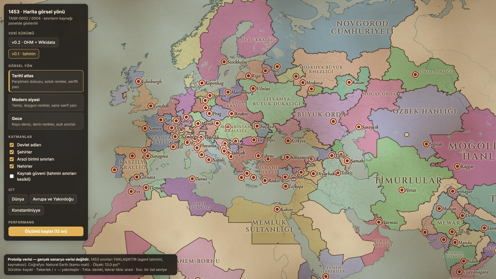
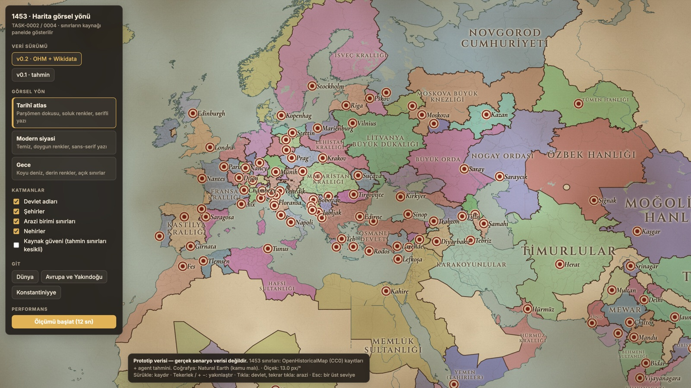
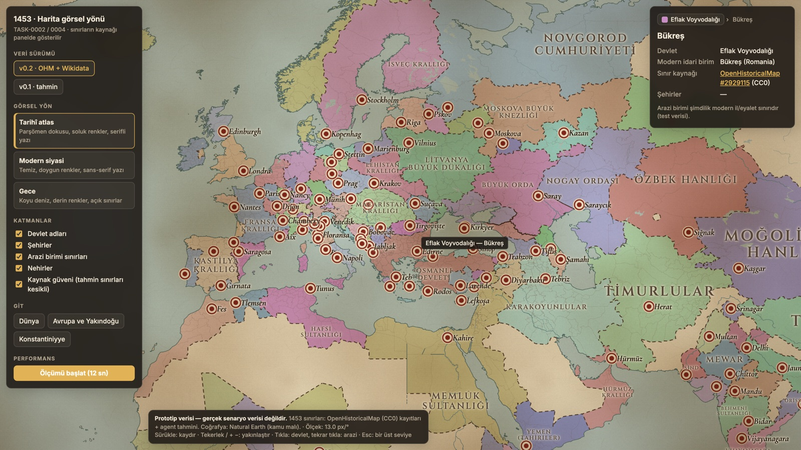

# 1453 haritası v0.2 — kaynak karşılaştırması (TASK-0004)

- **Tarih:** 2026-10-29
- **Durum:** KARARA BAĞLANDI — DEC-0022 uygulandı (Napoli ayrı, Dağıstan Gazikumuk, Urfa Akkoyunlu, varsayılan v0.2)
- **Yöntem:** DEC-0021, karma yöntem. Senaryo anı **1453-04-01**, Konstantiniyye'nin fethinden
  önce (AT-002).
- **Veri:** `prototypes/harita-gorsel-02/public/veri/dunya-1453-v02.json`,
  `public/veri/wikidata-1453.json`. Lisans kaydı: `prototypes/harita-gorsel-02/scripts/ohm-kayitlari.json`.

## 1. OpenHistoricalMap kayıtları

Ayrıntı bölgesinde (29–49°K, 12–50°D) 1453-04-01'de geçerli **49 sınır kaydı** bulundu. Aynı
devletin iki sürümü varsa daha erken biten sürüm tutuldu; tek örnek Cenova.

| Durum | Sayı | Açıklama |
|---|---|---|
| İçe aktarıldı | **34** | CC0 lisanslı; kaynak etiketi Commons/Wikipedia değil |
| Agent incelemesiyle reddedildi | 2 | Lisansı uygun ama 1453'ü yansıtmıyor (aşağıda) |
| Yalnızca referans | 11 | Kaynak etiketi Wikimedia Commons / Wikipedia haritası (CC BY-SA riski) |
| Kullanılamaz | 2 | OHM'de sınır geometrisi yok, yalnızca etiket noktası var |

**Reddedilen kayıtlar:**

| Kayıt | Gerekçe |
|---|---|
| Ottoman Empire (1354–1456) | Poligon yalnızca Bitinya ve Gelibolu'yu kapsıyor, yani 1354 durumu. 1453 için geçersiz. |
| Empire of Trebizond (1204–1461) | Kırım'daki Perateia'yı içeriyor, yani 13. yüzyıl durumu. 1453'te Trabzon yalnızca Doğu Karadeniz kıyısındaydı. |

**Yalnızca referans:** Bizans (Eastern Roman Empire), Napoli Krallığı, Sicilya Krallığı,
Kandiye, Nakşa Dükalığı, İyon Adaları, Napoli'nin 3 eyaleti, Molise, Freising.

**Kullanılamaz:** Macaristan Krallığı, Benevento.

**Uygulama:** Her modern idari birim, OHM poligonlarıyla öncelik sırasına göre (önce özgül alt
düzeyler) kesildi. OHM'nin kapsamadığı kısım tahmin kuralıyla atandı. Elle bölünen
Konstantiniyye korundu. Sonuçta 500 birim OHM sınırına göre ayarlandı, 353 yeni parça oluştu.

## 2. Devlet bazında sonuç (ayrıntı bölgesi)

- **Güven düzeyi:** Devletin alanının en az %80'i OHM kaynaklıysa "orta", değilse "düşük".
  "Yüksek" düzey, tarihçi doğrulaması olan veri için ayrıldı ve bu sürümde kullanılmıyor.
- **"OHM payı" ve "v0.1 ile aynı" sütunları:** Bu tablo ayrıntı bölgesindeki birimlerin temsil
  noktalarından hesaplandı. Güven düzeyi ise devletin tüm alanından hesaplandığı için iki değer
  farklı olabilir; örneğin Lehistan'ın bölgedeki kısmı %100 OHM kaynaklı ama tüm alanının
  güveni "düşük".
- **historical-basemaps:** GPL-3.0 lisanslı; yalnızca karşılaştırma için okundu, içe aktarılmadı.

| Devlet | Güven | OHM payı | v0.1 ile aynı | historical-basemaps 1400 | historical-basemaps 1492 |
|---|---|---|---|---|---|
| Karakoyunlular | düşük | %0 | %100 | Timurid Empire %99 | White Sheep Turks %99 |
| Memlûk Sultanlığı | düşük | %86 | %96 | Mamluke Sultanate %69 | Mamluke Sultanate %75 |
| Osmanlı Devleti | düşük | %0 | %100 | Ottoman Empire %55; Seljuk Caliphate %16 | Ottoman Empire %100 |
| Büyük Orda | düşük | %74 | %85 | Blue Horde %100 | Golden Horde %65 |
| Macaristan Krallığı | düşük | %0 | %100 | Kingdom of Hungary %96 | Imperial Hungary %93 |
| Kırım Hanlığı | düşük | %64 | %66 | Blue Horde %100 | Crimean Khanate %71 |
| Akkoyunlular | düşük | %0 | %100 | Timurid Empire %88 | White Sheep Turks %88 |
| Boğdan Voyvodalığı | düşük | %0 | %100 | Hungary %48; Moldova %48 | Poland-Lithuania %89 |
| Aragon Krallığı | orta | %100 | %27 | Sicily %97 | Aragón %97 |
| Eflak Voyvodalığı | orta | %100 | %96 | Wallachia %98 | Ottoman Empire %98 |
| Karamanoğulları | düşük | %0 | %100 | Seljuk Caliphate %55; Ottoman %45 | Ottoman Empire %100 |
| Çerkes Beylikleri | orta | %100 | %98 | Blue Horde %100 | Crimean Khanate %63 |
| Sırp Despotluğu | düşük | %0 | %100 | Bosnia %66 | Ottoman Empire %100 |
| Venedik Cumhuriyeti | düşük | %60 | %95 | HRE %40; Byzantine %18 | Venice %41 |
| Papalık Devleti | orta | %100 | %99 | Papal States %91 | Papal States %100 |
| Napoli Krallığı | orta | %100 | %95 | Sicily %93 | Aragón %93 |
| Kıbrıs Krallığı | orta | %100 | %62 | Cyprus %97 | Cyprus %97 |
| Atina Dükalığı | orta | %100 | %42 | Byzantine Empire %100 | Ottoman Empire %100 |
| Teodoro Prensliği | orta | %100 | yeni | Blue Horde %100 | Crimean Khanate %100 |

**Değerlendirme:** historical-basemaps 1400 haritası 1453'ten yarım yüzyıl önceyi gösteriyor ve
yer yer döneme uymuyor ("Seljuk Caliphate"). 1492 haritası ise fetihler sonrasını gösteriyor;
Karaman, Sırbistan ve Mora artık "Ottoman". Bu nedenle bu kaynak bir doğruluk ölçütü olarak
değil, yalnızca büyük çelişkileri yakalamak için kullanıldı.

### v0.1 → v0.2 en büyük değişiklikler

| Değişiklik | Alan (derece², projeksiyonlu) | Değerlendirme |
|---|---|---|
| ~~Napoli Krallığı → Aragon Krallığı~~ | 8,25 | ✔ DEC-0022/1 ile geri alındı: Napoli ayrı devlet |
| Çerkes Beylikleri → Kırım Hanlığı | 5,56 | ⚠ OHM'nin Kırım poligonu Kuban'a uzanıyor; Kuban'ın 1453'te Kırım'a bağlı olması tartışmalı |
| ~~Gazikumuk Şamhallığı → Büyük Orda~~ | 4,73 | ✔ DEC-0022/2 ile geri alındı |
| Büyük Orda → Kırım Hanlığı | 4,55 | Bozkır sınırı; iki kaynak da belirsiz |
| Nogay Ordası → Büyük Orda | 2,99 | Bozkır sınırı |
| Akkoyunlular / Dulkadiroğulları → Memlûk | 2,35 → 1,79 | ✔ DEC-0022/3: Malatya ve Antep Memlûk'te, Urfa Akkoyunlu'ya döndü |
| Litvanya → Lehistan (Podolya) | 0,81 | ✔ Batı Podolya 1434'ten beri Leh eyaleti |
| Osmanlı → Atina Dükalığı (Beotya, Teb) | 0,57 | ✔ Wikidata da 1453 başkentini Teb gösteriyor |
| Kırım Hanlığı → Cenova (Gazarya), Teodoro | 0,60 | ✔ Kefe ve Kırım kıyısındaki Cenova kolonileri; Mangup merkezli Teodoro |

## 3. Wikidata (CC0)

Ayrıntı bölgesindeki **45 devletin tamamı** Wikidata'da eşleşti. Arama sonucu 1453'ü
kapsamayan Macaristan ve Candaroğulları için kimlikler elle doğrulandı. Sonuçlar bilgi
panelinde Wikidata satırı olarak görünüyor.

- **Başkentler, tarihli olarak eşleşenler (11):** Edirne, Konstantiniyye, Diyarbakır, Tiflis,
  Bobovac, Venedik, Buda, Suçava, Kırkyer (Çufutkale), Vilnius, Herat.
- **Wikidata ile düzeltilenler (2):**
  - Candaroğulları: başkent Kastamonu → **Sinop**.
  - Atina Dükalığı: başkent Atina → **Teb**.
- **Tarih bilgisi olmayan, uyumlu olanlar:** Mistra, Trabzon, Karaman, Elbistan, Adana, Tebriz,
  Kahire, Tırgovişte, Kazan, Saraycık ve diğerleri.
- **Farklılıklar (değiştirilmedi, karar sizde):**
  - Sırp Despotluğu: Wikidata Belgrad diyor (tarihsiz). Belgrad 1427'de Macaristan'a geçti; 1453
    başkenti Semendire olarak kaldı.
  - Arnavut Beyleri Birliği: Wikidata Leş diyor. Birlik Leş'te kuruldu, ama İskender Bey'in
    merkezi Akçahisar olarak kaldı.
  - Dağıstan: Wikidata eşleşmesi Tarki Şamhallığı (merkez Tarki daha sonraki dönem). Gazikumuk
    adı ve merkezi korundu.
  - Büyük Orda araması Altın Orda kaydını (1243–1502) döndürdü; dönem yine de 1453'ü kapsıyor.
- **Hükümdarlar:** Wikidata'daki devlet kayıtlarında devlet başkanı (P35) tarih bilgisiyle
  tutulmuyor, bu yüzden 1453 hükümdarları bu yolla alınamadı. Karakter ve hanedan çalışmasında
  (Aşama 7) kişi kayıtlarındaki görev bilgisiyle (P39) alınmalı.

## 4. Haritada güven gösterimi

- **"Kaynak güveni" katmanı:** Açıldığında, en az bir yanı tahmine dayanan devlet sınırları
  kesikli çizilir. İki yanı da OHM kaynaklı sınırlar düz kalır.
- **Bilgi paneli:**
  - Devlet seçildiğinde: OHM payı, güven düzeyi, Wikidata kaydı ve 1453 başkenti.
  - Arazi seçildiğinde: sınırın kaynağı (OHM kayıt bağlantısı ya da "tahmin").
- **Sürüm geçişi:** Panelden v0.1 (yalnızca tahmin) ile v0.2 arasında geçiş yapılabilir.

### Görseller

| v0.1 (tahmin) | v0.2 (OHM + tahmin) |
|---|---|
|  |  |

Kaynak güveni katmanı açık (tahmine dayanan sınırlar kesikli):

Arazi seçimi ve kaynak bilgisi:

## Kullanıcı kararları (DEC-0022 ile uygulandı)

1. **Napoli:** Ayrı bir krallık olarak mı kalsın (v0.1), yoksa OHM'deki gibi Aragon'un parçası
   mı olsun? 1453'te iki tacı da V. Alfonso taşıyordu. **Önerim:** ayrı devlet; ortak hükümdar
   ileride hanedan sistemiyle gösterilir.
2. **Dağıstan:** OHM'deki Büyük Orda ataması geri alınsın mı? **Önerim:** geri alınsın, Gazikumuk
   Şamhallığı kalsın.
3. **Güneydoğu Anadolu:** OHM'nin Memlûk sınırı (Malatya, Antep, Urfa çevresi) kabul edilsin mi?
   **Önerim:** Malatya ve Antep Memlûk'te kalsın, Urfa Akkoyunlu'ya dönsün.
4. **Varsayılan sürüm:** Prototip v0.2 ile mi açılsın? Şu an öyle.
