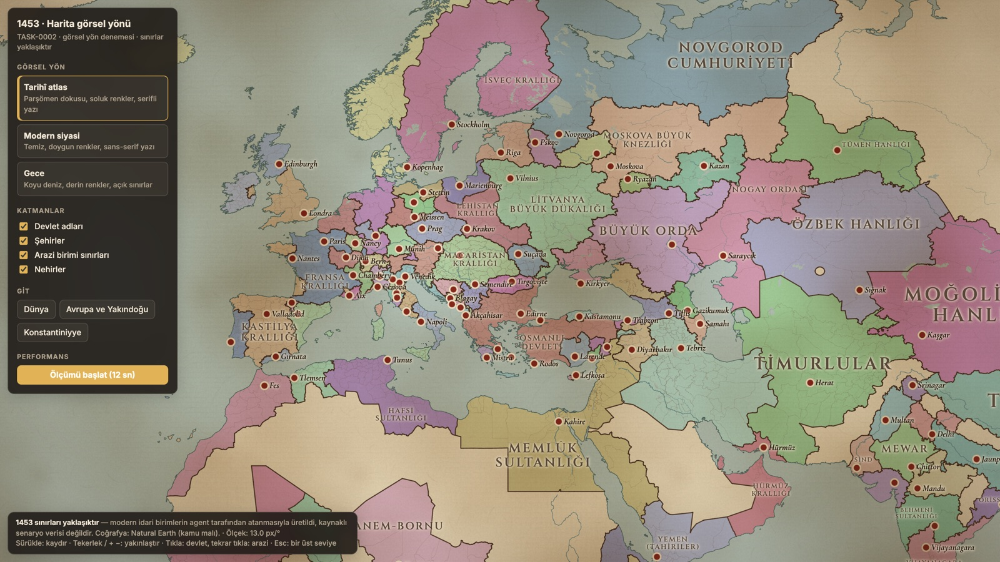
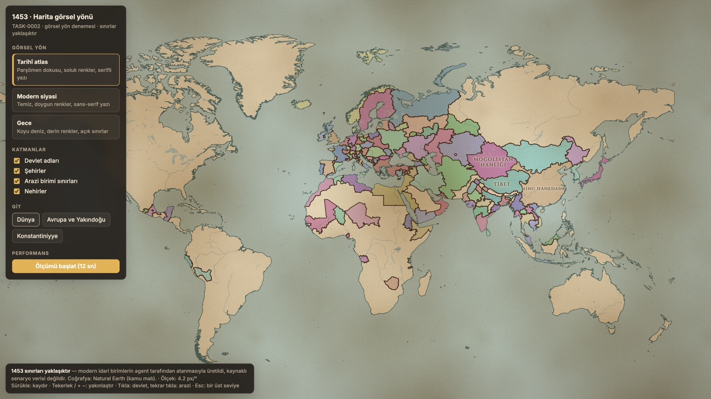
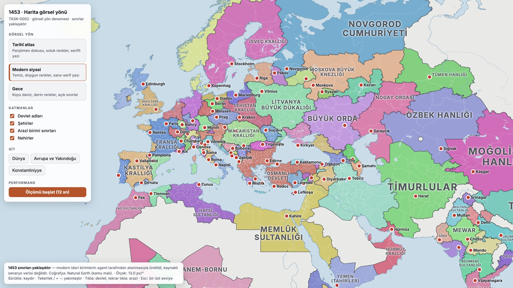
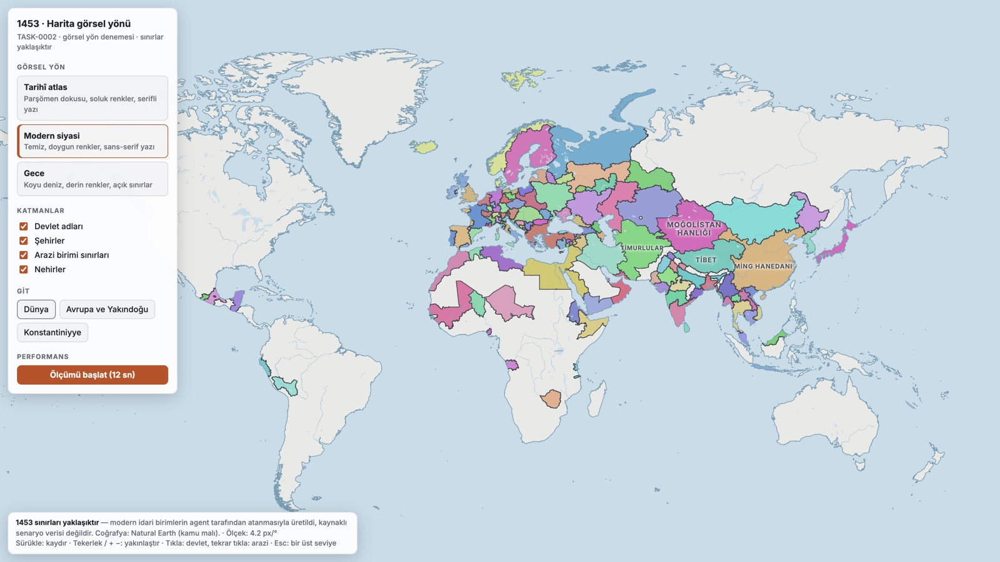
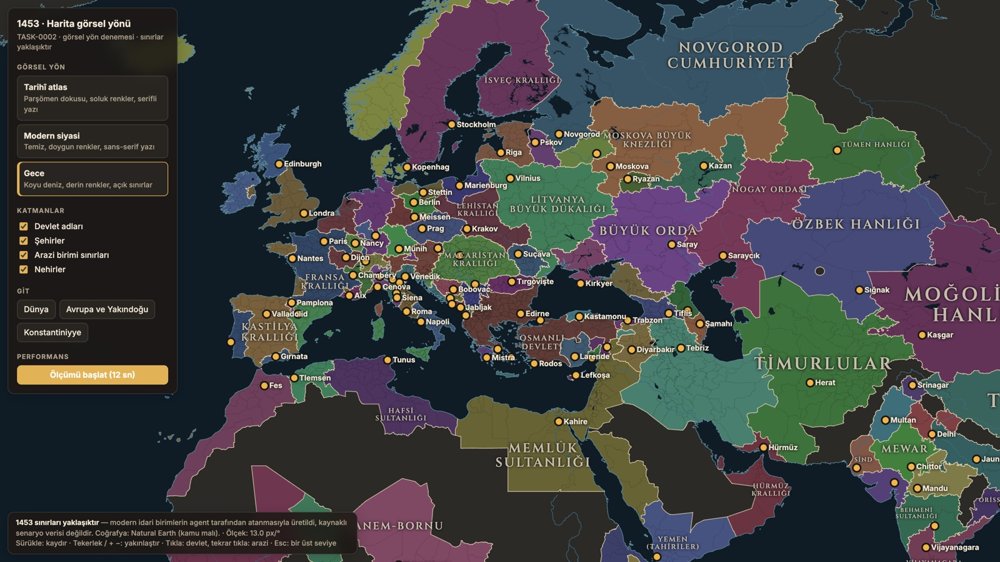
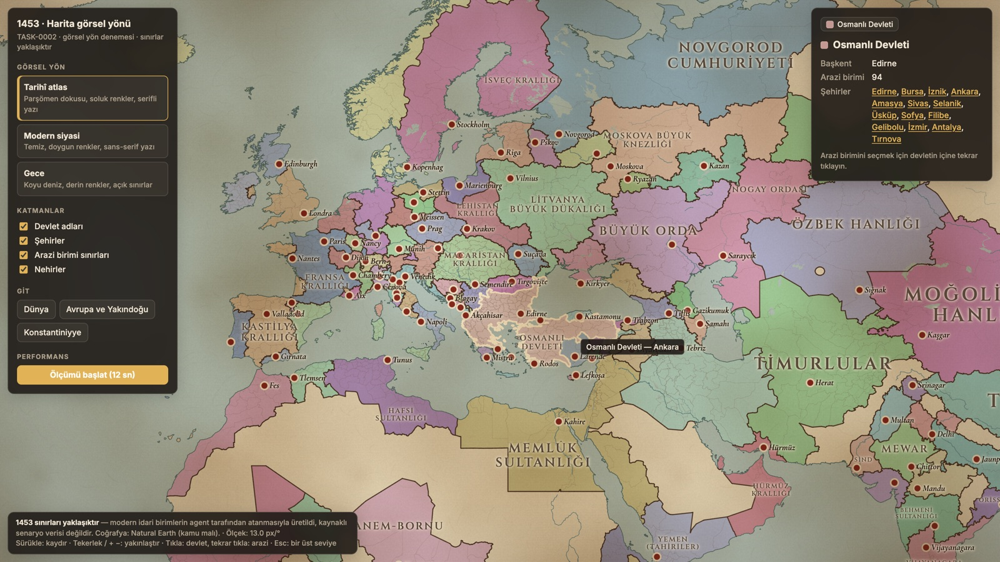
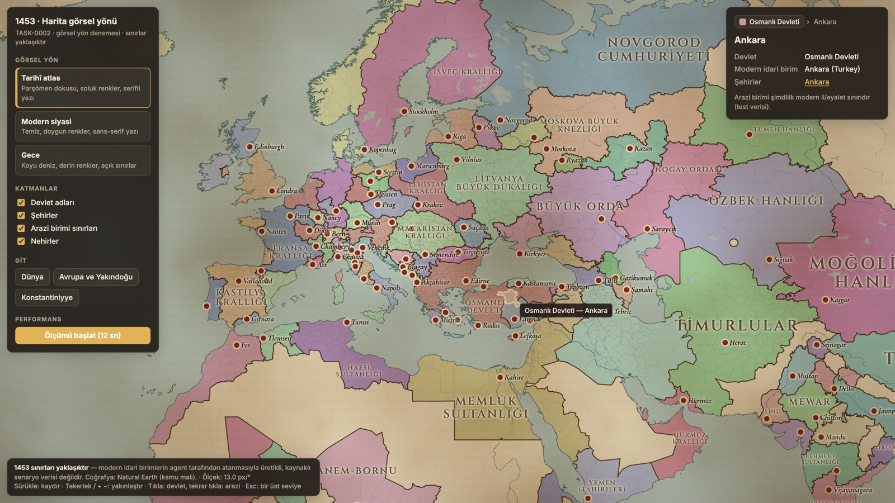
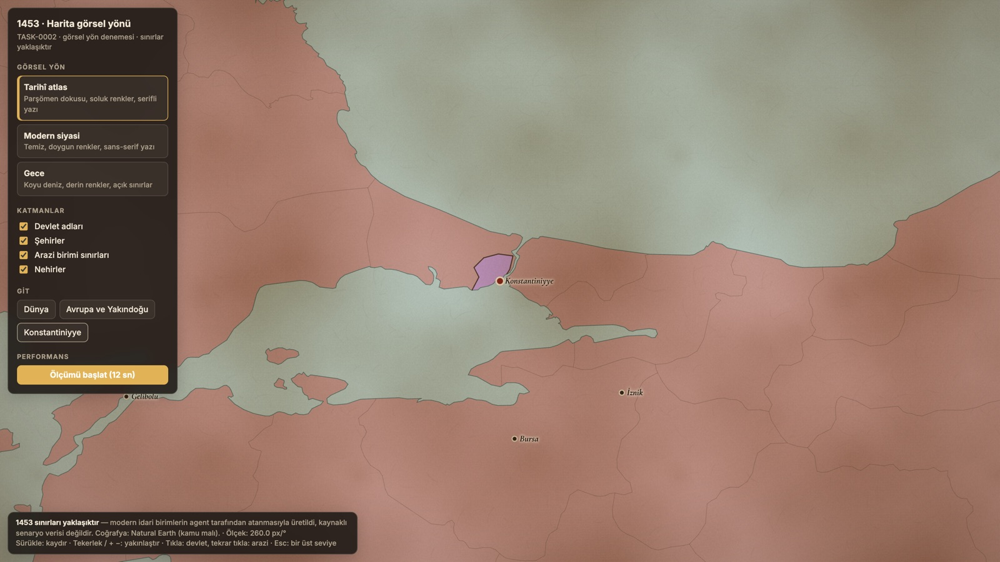

# Harita görsel yön denemeleri (TASK-0002)

- **Durum:** KARARA BAĞLANDI — **Tarihî atlas** seçildi (DEC-0018); Aşama 1 kapısı geçildi (DEC-0019).
  Seçimden sonra başkent işaretleri belirginleştirildi (halka + nokta, büyük kalın ad).
- **Tarih:** 2026-10-29
- **Prototip:** `prototypes/harita-gorsel-02/`. Çalıştırmak için `npm install && npm run dev`.
  Temalar prototip içinden anında değiştirilebilir.
- **Veri:** Natural Earth gerçek dünya coğrafyası ve **yaklaşık** 1453 sınırları. Ayrıntı:
  `docs/historical-sources/1453-yaklasik-sinirlar.md`.

Üç yön de aynı harita verisini, aynı etkileşimi ve aynı katman yapısını kullanır. Aralarındaki
fark yalnızca görünüştedir.

## 1. Tarihî atlas

Parşömen dokusu, soluk ve toprak tonlu devlet renkleri, kahverengi mürekkep sınırlar, Cinzel
yazı tipinde devlet adları, Cormorant Garamond italik şehir adları, kenarlarda hafif kararma.

- **Güçlü yanı:** Oyunun tarihî kimliğini en çok bu yön yansıtıyor ve diğer oyunlardan ayrışıyor.
- **Zayıf yanı:** Soluk renkler yan yana gelince ayırt edilmesi zorlaşabilir. Doku, uzun
  oturumlarda gözü yorabilir.

## 2. Modern siyasi

Temiz, doygun renkler, beyaz arazi sınırları, koyu devlet sınırları, Inter yazı tipi.

- **Güçlü yanı:** Okunabilirliği en yüksek yön. Renkler net ayrışıyor ve küçük devletler kolay
  seçiliyor.
- **Zayıf yanı:** Tarihî hava zayıf. Bir atlastan çok güncel bir ders kitabı haritası gibi duruyor.

## 3. Gece

Koyu deniz, derin renkler, açık renkli sınırlar ve yazılar.

- **Güçlü yanı:** Uzun oturumlarda göz yormuyor. Koyu arayüz panelleriyle uyumlu.
- **Zayıf yanı:** Renkler karanlıkta birbirine yaklaşıyor. Devlet sınırını ayırt etmek, açık
  temalara göre daha çok çaba istiyor.

## Ortak etkileşim (üç temada aynı)

- **Seçim hiyerarşisi:** İlk tıklama devleti seçer. Aynı devletin içine tekrar tıklamak arazi
  birimini seçer. Şehir noktasına tıklamak şehri seçer. Esc bir üst seviyeye çıkar. Bilgi
  panelindeki kırıntı yolu da (Devlet › Arazi › Şehir) tıklanabilir.

  
  
- **Etiketler:** Devlet adları devletin en geniş iç dairesine sığacak boyutta yazılır. Sığmayan
  ya da çakışan etiket gizlenir. Öncelik sırası: büyük devletler, başkentler, diğer şehirler.
- **Ayrıntı düzeyi:** Başkentler yaklaşık 6 px/° ölçekte, diğer şehirler 14 px/° ölçekte görünür.
  Arazi sınırları 9–20 px/° arasında yumuşak geçişle belirir. Büyük nehirler erken, küçük
  nehirler daha yakında görünür.
- **Yakın görünüm (Konstantiniyye):**

  

## Performans (Apple M2, Chrome headless, 3200×1800 çizim)

| Tema | Ort. FPS | Kare p95 | Render CPU ort. | Etiket güncelleme ort. / p95 | Çizim çağrısı |
|---|---|---|---|---|---|
| Tarihî atlas | 60 | 16,7 ms | 0,22 ms | 0,16 / 0,3 ms | 9 |
| Modern siyasi | 59,6 | 16,8 ms | 0,19 ms | 0,18 / 0,3 ms | 9 |
| Gece | 60 | 16,7 ms | 0,22 ms | 0,17 / 0,3 ms | 9 |

- **Harita boyutu:** 3.488 arazi birimi, 301 bin üçgen, 4,1 MB veri dosyası.
- **Kurulum:** Katmanlar yaklaşık 120 ms, ilk kare 40–70 ms. JS belleği 38 MB.
- **Ölçüm yolu:** Dünya görünümünde kaydırma, Konstantiniyye'ye yakınlaşma, ardından Avrupa'ya
  uzaklaşma. Ham sonuçlar: `prototypes/harita-gorsel-02/olcumler-2026-10-29-chrome-headless-apple-m2.json`.
- **Not:** "Etiket güncelleme" yalnızca JS süresidir. Tarayıcının stil ve yerleşim maliyeti kare
  süresinin içindedir; kare süresi yine de 60 Hz sınırında kaldı.

## Teknik notlar

- **Etiketler DOM'da:** TASK-0002 kartı SDF/MSDF (WebGL içinde) yazı önermişti. Prototipte DOM
  katmanı seçildi, çünkü tipografi kalitesi daha yüksek ve kodu daha basit. Ölçümde sorun
  çıkmadı. Ordu simgeleri ve yüzlerce dinamik etiket geldiğinde yeniden değerlendirilmeli.
- **Kâğıt dokusu:** Önce three.js katmanında denendi. Yakın ölçekte doku büyüyüp ızgara gibi
  görününce ekran üstü CSS katmanına (`mix-blend-mode: multiply`) taşındı. Artık her ölçekte
  keskin, ancak harita kaydırılırken doku yerinde kalıyor.
- **Çizim sıklığı:** Harita yalnızca bir değişiklik olduğunda yeniden çiziliyor
  (ADR-0001 önerisi 2 uygulandı).

## Kullanıcıdan istenen karar

1. Hangi yön temel alınsın? Bir yön ya da yönlerin bir karışımı da seçilebilir. Örneğin "atlas
   dokusu + modern renk doygunluğu".
2. Görsel yön ve etkileşim (seçim hiyerarşisi, etiket davranışı) Aşama 1 kapısı için yeterli
   mi?
